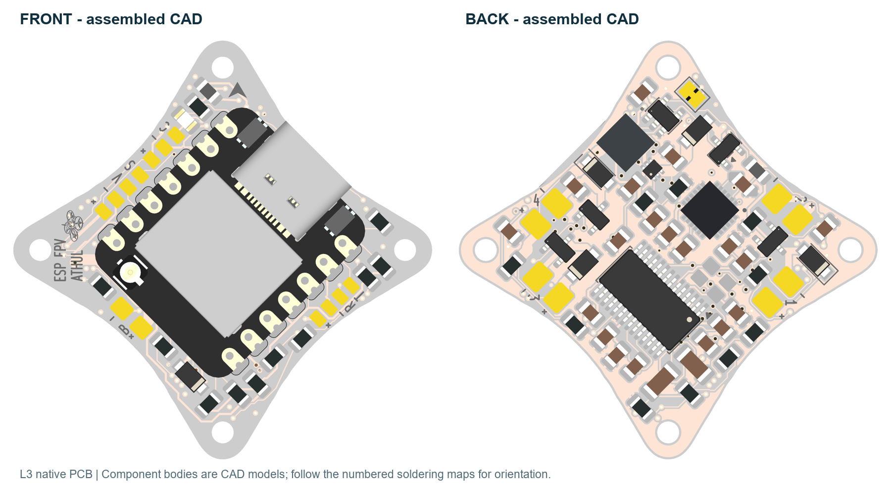

# ESPFC WHOOP

ESP FPV / ATHUL - MATRIX40 L3 hardware for a 1S brushed FPV flight-controller project, built around the Seeed XIAO ESP32-S3, MPU-6050 and AT7456E analog OSD.

## Start here

- [User manual](02_Guides/ESP_FPV_ATHUL_Brochure_L3.pdf): connections, configuration, installation and troubleshooting.
- [Assembly and component guide](02_Guides/ESP_FPV_ATHUL_Component_Map_L3.pdf): component values, closeups, pin 1, polarity and hidden XIAO contacts.
- [Purchase BOM](03_BOM_and_Purchase/ESP_FC_L2_Purchase_BOM.xlsx): quantities and Robu, Quartz Components and Evelta links. Search-only links and unconfirmed candidates are marked.
- [All-reference BOM CSV](03_BOM_and_Purchase/ESP_FC_L2_BOM_All_75_References.csv): all 75 board references, including 62 fitted component packages and integral PCB features.
- [Package instructions](START_HERE.txt).

## PCB fabrication

Upload only [the PCB-only Gerber ZIP](01_JLCPCB_UPLOAD/ESP_FC_L3_PCB_ONLY_GERBERS.zip) to JLCPCB for bare-board fabrication. It contains 11 Gerber layers, separate plated/nonplated drill files and PCB order notes. It contains no BOM or component purchasing data. Components are assembled at home.

Order four layers, 40 x 40 mm outline, 1.00 mm FR4, ENIG, white solder mask and black legend. Specify 1 oz / 35 um copper on **all four layers**, including the inner layers. Standard through vias are used; the minimum drill is 0.20 mm. Mounting holes are four 2.10 mm NPTH holes. The measured mounting square is 24.65 mm, rotated 45 degrees in the board view; it is not a 25.5 mm pattern.

The final L3 KiCad checks after zone refill have **0 electrical DRC errors, 0 warnings, 0 unconnected items, 0 schematic parity issues and 0 ERC violations**. All former 55 PCB warnings are resolved, with no PCB DRC checks disabled or exclusions added. ERC uses the unchanged project rules. Independent Gerber/drill, solder-mask and exposed-die checks pass. This is a prototype fabrication revision; assembled supply behavior, motor loading and flight operation still require bench validation. Confirm the fabricator's manufacturing proof before production.

L3 corrects nine short track approaches to terminate at via centers. Printed connector names use compact codes: **B** battery, **C** camera video, **V** video out, **S** SmartAudio, **R** FC RX and **T** FC TX. Polarity marks use 0.15 mm stroke vector symbols. All footprints, component values, pad nets and mounting dimensions are unchanged; the L2-named purchase BOM remains applicable.

See [manufacturing notes](02_Guides/MANUFACTURING_README.md) and [verification records](05_Verification/).

## Open the design

Open [ESP_FPV_ATHUL_IOGROUPED.kicad_pro](04_KiCad_Project/ESP_FPV_ATHUL_IOGROUPED.kicad_pro) in KiCad 10. Keep the child schematics, local symbol/footprint libraries and models alongside the project. The project is self-contained apart from KiCad's standard installation libraries.

## Firmware and assembly requirements

No ready-to-fly firmware is included. The L3 pin assignments are **IMU SDA GPIO5, IMU SCL GPIO43 and motor 3 PWM GPIO39**. Default XIAO SCL GPIO6 is PWM4 on this PCB. Configure I2C explicitly, manage UART0 TX output on GPIO43, and initialize motor outputs low before motor power.

Read [the firmware pin map](02_Guides/FIRMWARE_PINMAP.md) and [assembly notes](02_Guides/ASSEMBLY_NOTES.md). C17 is fitted at 220 pF C0G; C20 is 2.2 nF X7R 50 V. The MPU-6050 is a bare QFN-24, not a breakout module. First power should use a current-limited supply with motors disconnected. Remove propellers for output checks.

## Package contents

| Folder | Contents |
| --- | --- |
| `01_JLCPCB_UPLOAD` | PCB-only fabrication ZIP |
| `02_Guides` | User manual, assembly guide, PCB views and engineering notes |
| `03_BOM_and_Purchase` | Purchase workbook and all-reference CSV |
| `04_KiCad_Project` | Current editable PCB, schematic, libraries and models |
| `05_Verification` | KiCad, geometry, mask, via and Gerber checks |

`FILE_MANIFEST_SHA256.json` records checksums for the release package. The PCB images are CAD renders, not photographs. Older layout trials are not included.
